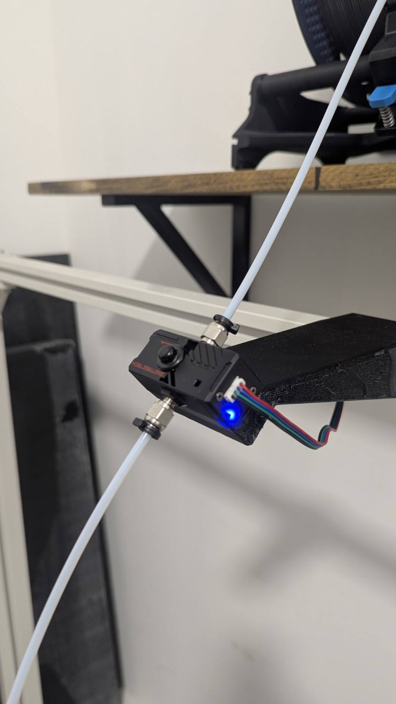
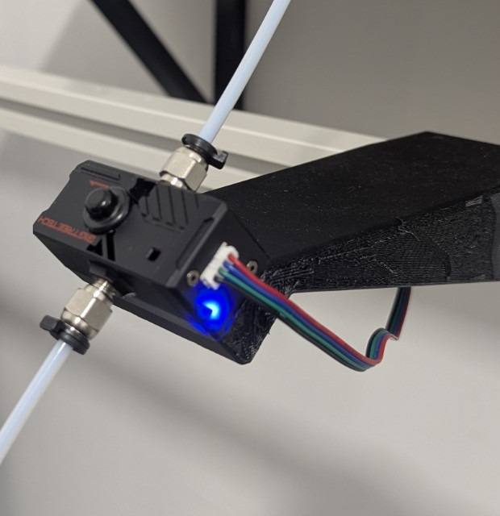
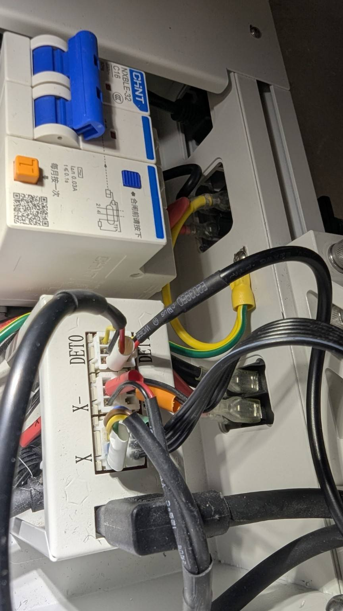
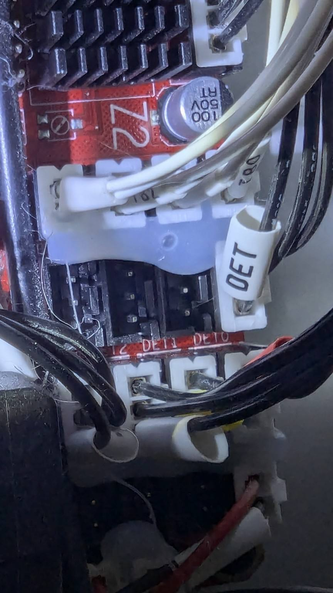
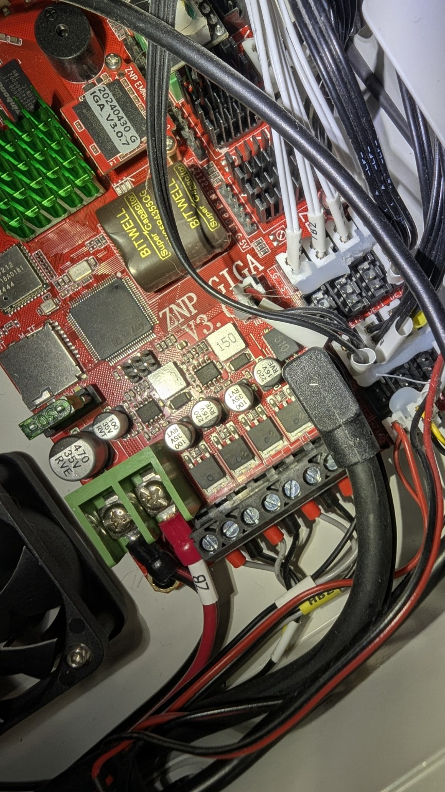
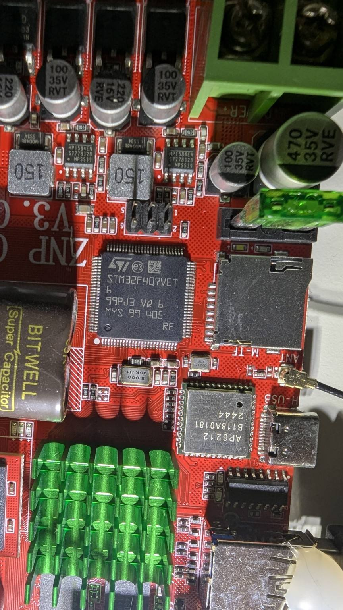

# BTT SFS V2.1 on Elegoo OrangeStorm Giga

> Hardware identification corrected on 11 October 2026: the owner confirms that every physical test, measurement, photograph, mount and wiring observation on this OrangeStorm Giga used a BTT Smart Filament Sensor V2.1 from the beginning. Earlier V2.0 labels for this installation were incorrect. External V2.0 documentation retains its original scope; no universal V2.0/V2.1 equivalence is asserted.

> This public guide covers the tested hardware. Use the current [GapGuard installation](../INSTALLATION.md); historical native sensor sections must not be enabled alongside GapGuard. FlowQ is information-only: no pause, resume, cancel or PD3/PD4 decision.

This guide documents a tested installation of a **BIGTREETECH Smart Filament Sensor V2.1** on an **Elegoo OrangeStorm Giga** using the original **ZNP GIGA V3.0** motherboard.

It is the hardware companion to GapGuard 4.2.0-rc1. The separate S1+ watcher provides information only.

> [!IMPORTANT]
> This pin mapping was validated on one OrangeStorm Giga equipped with a **ZNP GIGA V3.0** board and an **STM32F407VET6** MCU. Verify your board revision before reproducing the wiring on another hardware revision.

## Why this guide exists

A public OrangeStorm Giga BTT filament-sensor guide already exists and correctly points users toward the rear `DET0` and `DET1` connectors. However, that guide explicitly notes that the example `PD5` encoder pin is incorrect and leaves the actual `DET1` GPIO to be identified.

On the tested Giga, we verified the complete mapping:

| Function | Giga header | Klipper pin |
| --- | --- | --- |
| Filament presence / switch | `DET0` | `PD4` |
| Filament motion / encoder | `DET1` | `PD3` |

`PD3` was not guessed. It was identified by measuring the DET1 electrical signal and then observing the STM32 `GPIOD` input register while the SFS encoder changed state. The full method is documented below.

## Tested filament path

The tested installation uses an Infinity Flow S1+ upstream of the BTT SFS:

```text
Spool
  ↓
Infinity Flow S1+
  ↓
BTT SFS V2.1
  ↓
~1.2 m PTFE
  ↓
OrangeStorm Giga print head
```

The S1+ **actively pushes filament** toward the printer. This matters when tuning Klipper's `detection_length` because the mechanical behavior is different from a conventional passive spool → SFS → extruder path.

## Supplied SFS mount

The mount used on the tested printer is included in two matching geometry formats:

- [`orangestorm-giga-btt-sfs-v2.1-mount-remix.3mf`](../../hardware/orangestorm-giga-btt-sfs-v2.1-mount-remix.3mf) - cleaned **model-only 3MF**
- [`orangestorm-giga-btt-sfs-v2.1-mount-remix.stl`](../../hardware/orangestorm-giga-btt-sfs-v2.1-mount-remix.stl) - ready-to-slice STL exported from the same geometry

The public 3MF intentionally contains no printer, filament or slicer-profile metadata. It is **not a parametric CAD source file**.

The part is a **substantial remix** of `bowdenhalter-3.stl` by **T.L.**, originally published for an OrangeStorm Giga Bowden conversion with a fixed filament sensor:

- Original model: https://printables.com/model/1089979-elegoo-orangestorm-giga-bowden
- Original author profile: https://printables.com/@TL_158870
- Original license: **CC0 / Public Domain**
- CC0 reference: https://creativecommons.org/share-your-work/public-domain/cc0/

The original model was published on 28 November 2024. Its Printables model sheet explicitly allows remixing, redistribution and commercial use and does not require attribution. Attribution is nevertheless provided here because this remix was clearly inspired by that design.

This remix was reworked specifically around the **BTT SFS V2.1** and the mounting position used in this OrangeStorm Giga + Infinity Flow S1+ installation.

### Mount overview



### Mount detail



The mount is provided as-is. Print orientation, material and slicer settings should be chosen for your own installation environment. See [`hardware/README.md`](../../hardware/README.md) for model credits and file details.

## Rear DET0 / DET1 connection

The OrangeStorm Giga exposes `DET0` and `DET1` at the rear connection area.



The BTT SFS V2.1 uses two signals:

- presence / switch output → `DET0`
- motion / encoder output → `DET1`

On the tested machine, both rear connectors were traced back to the matching headers on the motherboard. `DET0` was already connected by the factory wiring. `DET1` required the additional cable used for this installation.

### BTT splitter cable and indicator behavior

The tested SFS V2.1 installation uses the following splitter harness:

```text
SFS V2.1
  │
  └── 4-pin connector
        ↓
     splitter
      ├── 3-pin motherboard connector → switch / presence signal
      └── 3-pin motherboard connector → motion / encoder signal
```

For this OrangeStorm Giga installation:

```text
switch / presence signal → DET0 → PD4
motion / encoder signal  → DET1 → PD3
```

The historical guide describes bidirectional filament passage. This generic property is not relabelled as a new manufacturer specification for V2.1; it does not establish universal equivalence between V2.0 and V2.1.

BIGTREETECH's documented LED behavior is also useful during commissioning:

```text
red LED illuminated      → no filament in the SFS
blue LED flashing        → normal filament movement
blue LED steady on/off   → possible when filament is stationary
```

Do not use the blue LED as an instantaneous Klipper state indicator. The Klipper `filament_motion_sensor` works from encoder events and commanded extrusion distance.

If you extend or remake the harness, preserve the functional pin mapping. Do not assume that extension-wire colors match the original BTT harness.

## Motherboard DET0 / DET1 headers

Always power the printer off before changing the wiring.

The motherboard connection area is shown below:



A wider view of the reference cable routing is included below:



For the photographed connector orientation used during the measurements:

```text
TOP    = SIGNAL
MIDDLE = GND
BOTTOM = +5 V
```

This was verified electrically on the tested printer. With the SFS connected, the `DET1` signal was observed at approximately:

```text
HIGH ≈ 4.5 V
LOW  ≈ 0.133 V
```

Do not rely on cable colors alone. Verify connector orientation and board revision before applying power.

## Verified GPIO mapping

### DET0 = PD4

The original OrangeStorm Giga Klipper configuration already identifies the stock filament-detection input as:

```ini
switch_pin: PD4
```

The BTT SFS presence output connected to `DET0` was then validated in both states with:

a historical native presence query (not an instruction for the GapGuard configuration)

Expected results:

```text
Filament inserted  → filament detected
Filament removed   → filament not detected
```

### DET1 = PD3

The stock configuration does not document the `DET1` GPIO.

On the tested stock configuration, `PD5` must **not** be repurposed for the SFS encoder. It is already used by the second Z stepper driver UART:

```ini
[tmc2209 stepper_z1]
uart_pin: PD5
```

This is another reason not to copy the incorrect `PD5` example sometimes seen in community instructions.

The tested motherboard uses an **STM32F407VET6**.



First, the SFS encoder signal was confirmed electrically at the `DET1` header by observing it switch between approximately `4.5 V` and `0.133 V`.

Klipper was then temporarily stopped and its MCU debug console was connected directly over CAN. The STM32F407 `GPIOD` input-data register (`GPIOD_IDR`, address `0x40020C10`) was read while the SFS encoder state was changed.

The observed values were:

```text
0x0000FF36
0x0000FF3E
0x0000FF36
```

The difference is:

```text
0xFF36 XOR 0xFF3E = 0x08
```

`0x08` is bit 3 of port D, therefore the changing input is:

```text
PD3
```

That result was then validated in Klipper by moving filament through the SFS and observing `sfs_motion` change state.

## Current GapGuard integration

The electrical observations above belong to the owner's SFS V2.1 installation. Register readings are archived measurements, not commands to run on a printing machine.

Use [INSTALLATION](../INSTALLATION.md), [CONFIGURATION](../CONFIGURATION.md), and the [public configuration extract](../../config/gapguard-example.cfg). GapGuard owns PD3/PD4 exclusively; do not enable the historical fila/sfs_motion objects in parallel.

Current public inspection commands are `GAPGUARD_STATUS` and `GAPGUARD_STATUS_DEBUG`. The other public macros are `GAPGUARD_PAUSE`, `GAPGUARD_ENABLE_FULL`, `GAPGUARD_ENABLE_PARTIAL`, and `GAPGUARD_DISABLE_ALL`. Manual resume/cancel remain Elegoo `RESUME` / `CANCEL_PRINT`.

The supplied profile uses 9 / 20 / 20 / 2. Its configurable thresholds are not a manufacturer accuracy specification. BIGTREETECH's external SFS V2.0 documentation gives a nominal 2.88 mm; it is not relabelled as a V2.1 measurement. Historical native detection_length tuning is not the current GapGuard algorithm.

All physical observations here concern the tested V2.1 installation. No universal mechanical or electrical V2.0/V2.1 equivalence is asserted.

## Mounting hardware and wiring

Source: owner's installation record, 13 September 2026, 15:19:35.

- 3 × M3 × 16 mm screws and 3 × M3 washers.
- 2 × M4 × 10 mm screws and 2 × M4 washers.
- 3-conductor electrical cable, 22 AWG, black PVC; length appropriate to the installation (under 10 m in the recorded setup).
- JST-XH, marketed as 2.54 mm, 3-pin male and female connectors; verify the actual matching connector before assembly.

On the tested DET0 connection the observed order was SIGNAL / GND / +5 V rather than the expected reversed orientation. Never infer polarity solely from the JST housing orientation. Physically verify SIGNAL, GND and +5 V on the actual connector.

## Reference photos and files

Included with this guide:

```text
docs/images/btt-sfs-v2.1/sfs-mount-overview.jpg
docs/images/btt-sfs-v2.1/sfs-mount-detail.jpg
docs/images/btt-sfs-v2.1/rear-det0-det1-panel.jpg
docs/images/btt-sfs-v2.1/det0-det1-motherboard.jpg
docs/images/btt-sfs-v2.1/det0-det1-cable-routing.jpg
docs/images/btt-sfs-v2.1/mcu-stm32f407vet6.jpg
hardware/orangestorm-giga-btt-sfs-v2.1-mount-remix.3mf
hardware/orangestorm-giga-btt-sfs-v2.1-mount-remix.stl
hardware/README.md
config/gapguard-example.cfg
```

## References

- Original mount inspiration: `bowdenhalter-3.stl` by T.L., “Conversion of the Elegoo OrangeStorm Giga to Bowden with fixed filament sensor”: https://printables.com/model/1089979-elegoo-orangestorm-giga-bowden
- Original author: https://printables.com/@TL_158870
- Original model license: CC0 / Public Domain: https://creativecommons.org/share-your-work/public-domain/cc0/
- BIGTREETECH Smart Filament Detection Module / SFS V2.0 documentation: https://github.com/bigtreetech/smart-filament-detection-module
- Jcw218 OrangeStorm Giga BTT sensor installation guide: https://github.com/Jcw218/JcwDrafting-GigaVoron/tree/main/BTT_smart_filament_detection_module_install_guide
- Klipper filament motion sensor configuration: https://www.klipper3d.org/Config_Reference.html#filament_motion_sensor
- ST STM32F405/407 reference manual (RM0090): https://www.st.com/resource/en/reference_manual/rm0090-stm32f407-advanced-armbased-32bit-mcus-stmicroelectronics.pdf

## Status

Installation identity: SFS V2.1 from the beginning, explicitly confirmed by the owner on 11 October 2026. Earlier V2.0 labels describing this machine were incorrect. Manufacturer/community sources explicitly about V2.0 retain that designation. No additional photograph is required to determine this installation's sensor revision.

Exact assets and their original archive names are recorded in [PROVENANCE](../../PROVENANCE.json). Photos and model bytes are unchanged. Models are released under [CC0 1.0](../../hardware/LICENSE); software licences remain separate.
